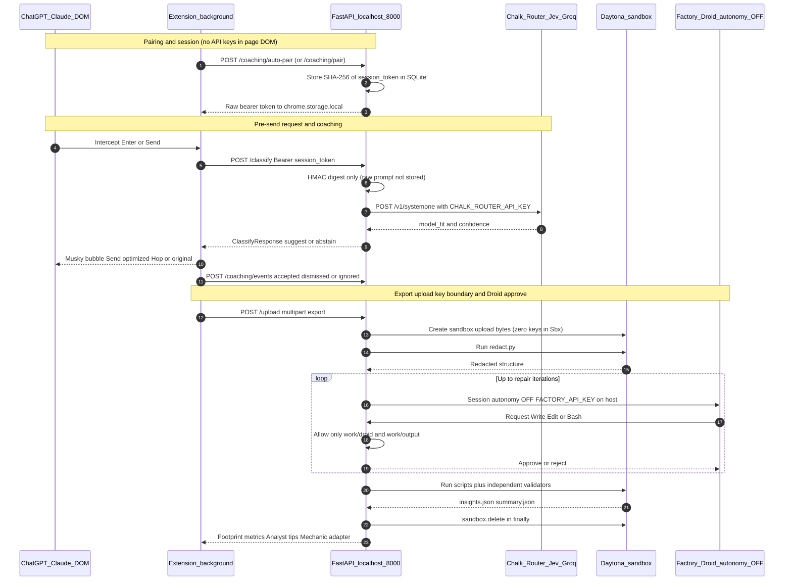

<p align="center">
  
</p>

<h1 align="center">touchgrass</h1>

<p align="center">
Everyone here used AI today. Nobody knows what it cost. touchgrass tracks usage, shows the energy, water, and CO₂ behind it, and coaches you before you send a wasteful prompt.
</p>

<p align="center">
A Chrome MV3 extension (Musky on ChatGPT and Claude) pairs with a FastAPI backend. Pre-send drafts go through Groq and Chalk/Jev. Chat exports and adapter repairs run through Factory Droid inside Daytona sandboxes, with our own validators deciding what ships.
</p>

<div align="center">

## Table of contents

[Stack](#stack)
[Request, approve, key, and session flow](#request-approve-key-and-session-flow) ·
[Folder map](#folder-map) ·
[How to run it](#how-to-run-it) ·
[How to test it](#how-to-test-it) ·
[Where to start reading](#where-to-start-reading)

### Docs

**Where each piece works**

[Where Droid works](docs/where-droid-works.md) ·
[Where Daytona works](docs/where-daytona-works.md) ·
[Where Chalk works](docs/where-chalk-works.md) ·
[Seen from space](docs/seen-from-space.md)

**How to wire and run**

[Coaching integration](docs/coaching-integration.md) ·
[Chalk setup](docs/chalk-setup.md) ·
[Chalk runbook](docs/chalk-runbook.md) ·
[Chalk CLI](docs/chalk-cli-reference.md)

[Try it with Droid](docs/try-it-with-droid.md) ·
[Architecture index](docs/droid-daytona-architecture.md)

Schemas:
[ingest attempt](docs/ingest-attempt.schema.json) ·
[normalized exchange](docs/normalized-exchange.schema.json) ·
[OpenAPI](docs/coaching-openapi.json)

</div>

## Stack

| Piece | Role | Deep dive |
| --- | --- | --- |
| **Chrome extension** (`extension/`) | WXT + React 19 + Tailwind. Content script on ChatGPT and Claude, floating Musky, pre-send classify (Groq `llama-3.1-8b-instant`), cross-tab hop, IndexedDB footprint ledger, popup + dashboard | [coaching-integration](docs/coaching-integration.md) |
| **Chalk + TypeSafe Jev** (`backend/coaching/`, `evals/`) | System One classifier via Model Gateway (`/v1/systemone`), ~700 ms budget, shadow/suggest policy, offline `chalkcompute` evaluations | [where-chalk-works](docs/where-chalk-works.md) |
| **Daytona** (`backend/sandbox.py`, `sandbox_jobs/`) | Ephemeral Linux sandboxes. Export uploaded from memory; `redact.py` before any LLM; deleted in `finally`. No API keys in the sandbox | [where-daytona-works](docs/where-daytona-works.md) |
| **Factory Droid** (`sandbox_jobs/droid_runner.py`) | `Session` with `autonomy=OFF` and a path-restricted permission handler. Writes parsers, analyses, and adapter repairs; we verify before publish | [where-droid-works](docs/where-droid-works.md) |
| **Space** (`space/`) | NASA GIBS / VIIRS night-lights for data-center regions; optional `your_share` next to latest insights | [seen-from-space](docs/seen-from-space.md) |

**Key boundary:** `CHALK_ROUTER_API_KEY`, `FACTORY_API_KEY`, and `DAYTONA_API_KEY` stay on the backend (or in build-time extension env for Groq). The page DOM never sees them. Extension auth is a bearer session token from pairing, stored in `chrome.storage.local`.

## Request, approve, key, and session flow



Homemade picture of the same path: pair once → classify drafts with a session token → uploads stay sandboxed → Droid asks before every write → our checks decide publish. Full measurements and privacy limits: [docs/droid-daytona-architecture.md](docs/droid-daytona-architecture.md).

## Folder map

```text
HackHarvard/
├── extension/          Chrome MV3 (WXT): content, popup, dashboard, Musky stickers
├── backend/            FastAPI app, coaching/, executors, adapters, demo_runs/
├── sandbox_jobs/       Code uploaded into each Daytona sandbox; Droid runners + lib/
├── evals/              Chalk eval prepare / run_local / run_chalk / parser_eval
├── space/              NASA GIBS night-lights insight
├── scripts/            pair_extension, chalk_doctor, coaching_artifacts
├── docs/               Runbooks, contracts, demo script, this architecture doc
├── start.py            Backend launcher (Daytona / local / --replay)
└── smoke_test.py       End-to-end upload + repair smoke
```

## How to run it

**Backend** (Python 3.12+, from repo root):

```sh
# copy .env.example → .env (FACTORY_API_KEY, DAYTONA_API_KEY, optional CHALK_*)
py start.py                          # Daytona if DAYTONA_API_KEY set, else local
py start.py --replay                 # saved demo runs, no live Droid
# or coaching factory style:
uv sync
uv run uvicorn backend.main:create_app --factory --host 127.0.0.1 --port 8000
```

Pairing: extension auto-pairs on startup via `POST /coaching/auto-pair`, or mint a code with `uv run python -m scripts.pair_extension` and `POST /coaching/pair`. API docs: http://127.0.0.1:8000/docs

**Extension:**

```sh
cd extension
npm install
# set WXT_GROQ_API_KEY in extension/.env if you want live Groq routing
npm run dev                          # load .output/chrome-mv3 in chrome://extensions
# or: npm run build
```

Keep the API on loopback for the hackathon demo. Set exact origins in `ALLOWED_ORIGINS` when needed.

## How to test it

```sh
# backend / sandbox jobs
uv run pytest
py smoke_test.py                     # both flows, Droid stand-ins, ~30 s, 0 credits
py smoke_test.py --live              # real Droid (~100k Factory credits)
py -m pytest sandbox_jobs/test_privacy.py

# chalk / coaching (mock/shadow, no billed inference required for doctor)
uv run python -m scripts.chalk_doctor

# extension
cd extension
npx vitest run
npx playwright test                  # or: npm run test:e2e
```

Live Chalk smoke and eval budgets: [docs/chalk-runbook.md](docs/chalk-runbook.md) and [docs/try-it-with-droid.md](docs/try-it-with-droid.md).

<div align="center">

## Where to start reading

1. This README — map, flow diagram, run/test.
2. [Where Droid works](docs/where-droid-works.md) ·
   [Where Daytona works](docs/where-daytona-works.md) ·
   [Where Chalk works](docs/where-chalk-works.md) ·
   [Seen from space](docs/seen-from-space.md)
3. [Coaching integration](docs/coaching-integration.md) — extension ↔ `/classify`.
4. [Chalk setup](docs/chalk-setup.md) → [Chalk runbook](docs/chalk-runbook.md) — keys, shadow policy, evals.
5. [Try it with Droid](docs/try-it-with-droid.md) — live verify + parser eval.
6. [Architecture index](docs/droid-daytona-architecture.md) — index of the deep dives above.

Honest limits (placeholder footprint numbers, hybrid Droid-on-backend because Factory domains are blocked from the sandbox, redaction leak of structure/lengths) live in the Daytona and Droid docs, not papered over here.

</div>
